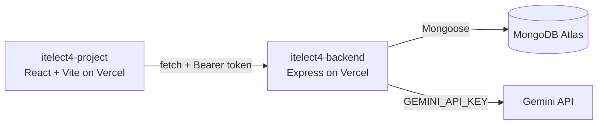

# ITELECT4 Backend

[](https://github.com/chesterboriz/itelect4-backend/actions/workflows/ci.yml)

Express + TypeScript + MongoDB REST API for the Campus Lost & Found system.

## 🔗 Live Links

| | URL |
|---|---|
| **Live Backend** | https://itelect4-backend-chi.vercel.app |
| **Live Frontend** | https://itelect4-project-nu.vercel.app |

## 🏗 Architecture



## 🛠 Tech Stack

- **Runtime**: Node.js + TypeScript
- **Framework**: Express.js
- **Database**: MongoDB Atlas (Mongoose)
- **Auth**: JWT (jsonwebtoken) + bcryptjs
- **Deployment**: Vercel (Serverless)

## 📡 API Endpoints

| Method | Route | Auth | Description |
|--------|-------|------|-------------|
| GET | `/api/health` | No | Health check |
| POST | `/api/auth/register` | No | Register user |
| POST | `/api/auth/login` | No | Login user |
| GET | `/api/courses` | No | List courses |
| GET | `/api/courses/:code` | No | Get course |
| GET | `/api/items` | No | List lost items |
| POST | `/api/items` | Yes | Report lost item |
| GET | `/api/items/:id` | No | Get item detail |
| GET | `/api/submissions` | Yes | List submissions |
| POST | `/api/submissions` | Yes | Create submission |
| POST | `/api/ai` | Yes | AI project review (Gemini) |

## 🚀 Run Locally

```bash
# Install dependencies
npm install

# Copy env file and fill in values
cp .env.example .env

# Start dev server
npm run dev
```

## ⚙️ Environment Variables

```env
MONGODB_URI=your_mongodb_connection_string
JWT_SECRET=your_jwt_secret
GEMINI_API_KEY=your_gemini_api_key
PORT=4000
CORS_ORIGIN=http://localhost:5173
```

## 🤖 AI-Use Disclosure

This project utilized AI assistance (Google Gemini / Antigravity) for automated test suite scaffolding, TypeScript type refinement, and CI workflow configuration in accordance with course guidelines.

